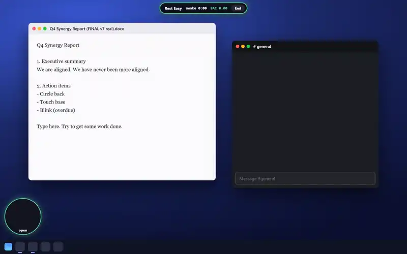
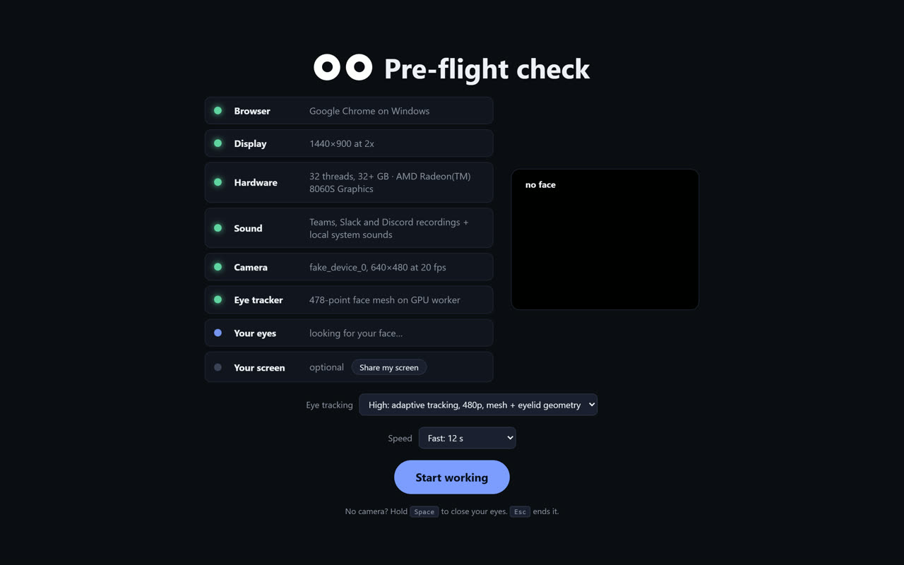
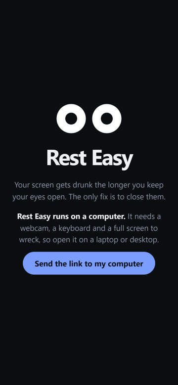

<div align="center">



# Rest Easy

Your screen gets drunk the longer you keep your eyes open. The only fix is to close them.

[**Try it at sih.matiass.ca**](https://sih.matiass.ca) · [Devpost](https://devpost.com/software/rest-easy-3xyzf7) · Stupid Ideas Hackathon, Ottawa, 15 Nov 2026

</div>

## How it works

Your webcam watches your eyes. While they are open, a "screen BAC" climbs. The picture starts to sway, then Teams calls, Slack pings, junk ads, meme sounds and surprise CEO cameos pile on, timed to the music. Close your eyes for a few seconds and it drains away. A bell tells you it is safe to look again.

1. **Pre-flight.** The setup screen checks your browser, display, camera and eye tracker. Blink twice so it knows it can see you.
2. **Start.** Share your screen first if you want your real desktop to be the thing that gets drunk.
3. **Rest.** Closing your eyes sobers the screen. When you open them you get a greeting with how long you rested and how much BAC you shed.



## Web and desktop

The desktop app is the way to play: your real desktop gets drunk and you keep working in it. The website asks where the run happens before Start: a Chrome tab (a whole screen or a window is refused, since you couldn't use it) or the practice desktop.

There is one app, in `web/`. The desktop version is a thin Electron shell in `desktop/` that loads the same page. It exists because a browser tab can't draw over your desktop or let clicks through to the apps underneath.

| | Web | Desktop |
|---|---|---|
| Run | `npm run web` | `npm run desktop` |
| What gets drunk | a live Chrome tab you can scroll, or, as a last resort, a practice desktop with a to-do list | your real desktop: live on Windows, a snapshot taken at Start on a Mac |
| Your apps stay usable | no | yes, clicks and typing pass through |
| Stop | End button, or hold Esc | End button, Ctrl+Alt+X or F9. Ctrl+Shift+Q quits |
| Rest without a camera | hold Space | Cmd+Shift+Space on a Mac, Ctrl+Shift+Space on Windows |



Phones and tablets get the landing page and a button that shares the link, so you can open it on a computer. The run itself needs a webcam, a keyboard and a full screen to wreck.

<br clear="right">

## Run it

Use Node 24 (`nvm use` reads `.nvmrc`). Node 26 can leave Electron's download half extracted.

```sh
npm install
npm run web       # http://127.0.0.1:8770
npm run desktop   # the overlay on your real desktop
npm test          # unit tests for device detection, the chaos mixer and the desktop launcher
```

`pnpm install` works too. If Electron's install is incomplete, run `pnpm rebuild electron` under Node 24.

Switches for rehearsing on the web version:

| Switch | Effect |
|---|---|
| `?rise=20` | seconds from sober to gone (the setup screen offers 7 to 35) |
| `?level=0.8` | start already drunk |
| `?cam=0` | skip the camera and hold Space to rest |
| `]` | add BAC |
| `?autorun=60&cycle=20` | a timed test run that rests every 20 s and logs a `PERF` line every 5 s |

On desktop, pass the same test run as `REST_EASY_QUERY="autorun=60&cycle=20" npm run desktop`. `REST_EASY_VISIBLE=1` lets screenshots see the overlay, which then also sees itself.

## Under the hood

- Eye tracking is MediaPipe Face Landmarker, a 478-point face mesh with blink scores, running in a web worker on your GPU. Video never leaves your device.
- Every screen effect is one WebGL shader. It uploads only new frames and drops resolution as the distortion grows.
- An audio analyser on the music drives the shader, the club lights and the ad bursts, so the chaos lands on the drop.
- There is no build step. `web/` is plain HTML, CSS and ES modules.

## Credits

Built by [Matias Suxo](https://github.com/matias-io), [Aditya Baindur](https://github.com/Aditya-Baindur) and [Esteban](https://github.com/estebanG2003).

The notification banners are parody recreations, not screenshots. The brands and recordings below belong to their owners and are not covered by any license in this repository.

| Asset | Source | License |
|---|---|---|
| Teams ringtone and message | Microsoft's installed Teams package | Microsoft |
| Slack "Knock Brush" | Slack's CDN | Slack |
| Discord message, ringtone, join and leave | Discord's CDN | Discord |
| PagerDuty alert | PagerDuty's Chrome extension | Apache 2.0, license bundled |
| Windows mail, calendar and system sounds | Windows | Microsoft |
| Android UI sounds | Android Open Source Project | Apache 2.0 |
| Meme sound effects | listed in [`web/vendor/chaos/README.md`](web/vendor/chaos/README.md) | no open license |
| Music: DEAF KEV, "Invincible" | NoCopyrightSounds | NCS terms |
| Sam Altman photo | TechCrunch, via Wikimedia Commons | CC BY 2.0 |
| Dario Amodei photo | Kimberly White / Getty Images for TechCrunch, crop by Nagae Iku, via Wikimedia Commons | CC BY 2.0 |
| Jensen Huang photo | Raysonho, via Wikimedia Commons | CC0 |
| Lori and Jensen Huang photo | Oregon State University Foundation | all rights reserved |
| Gym photo on the rest screen | supplied by the team, creator unknown | no license |
| Detective illustration | Twemoji, © Twitter, Inc. and contributors | CC BY 4.0 |
| Mark Zuckerberg and Theo Browne photos | not recorded | unknown |
| Brand icons | simple-icons | CC0 |

Sound sources and SHA-256 hashes are in [`web/vendor/sounds/sources.json`](web/vendor/sounds/sources.json). Photo sources are in [`web/vendor/img/feed/sources.json`](web/vendor/img/feed/sources.json), [`sam.source.json`](web/vendor/img/sam.source.json) and [`dario.source.json`](web/vendor/img/dario.source.json). `web/vendor/sounds/airhorn.ogg` is an old train-horn recording ("Sound of American Train Horn Nathan Airchime K5LA" by WeenyBeany, CC BY 4.0, via Wikimedia Commons) that no longer plays.
